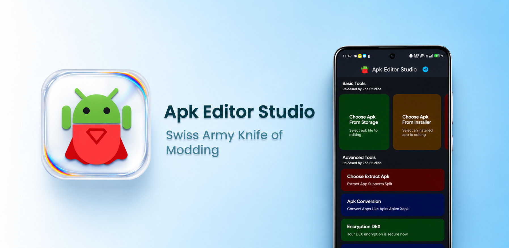

<p align="center">
  
</p>

<h1 align="center">🚀 Apk Editor Studio</h1>

<p align="center"><strong>The Swiss Army Knife of APK Modding.</strong></p>

<p align="center">
  
  
  
  
</p>

<p align="center">
  <a href="https://github.com/ZoeWasGreat/ApkEditorStudio/stargazers"></a>
  <a href="https://github.com/ZoeWasGreat/ApkEditorStudio/issues"></a>
  <a href="https://github.com/ZoeWasGreat/ApkEditorStudio"></a>
</p>

<p align="center">
  Apk Editor Studio is an Android APK editing and reverse-engineering toolkit built around the legacy APK Editor Master application. The project focuses on bringing its editing workflow to modern Android devices, improving compatibility with newer APK formats and Android platform restrictions, and refreshing the application under the Zoe Studios identity.
</p>

<p align="center">
  <strong>🧑‍💻 Original Developer:</strong> Rizki Rizaldi<br>
  <strong>✨ Updated &amp; Maintained by:</strong> Zoe Studios
</p>

<p align="center">
  <a href="https://github.com/ZoeWasGreat/ApkEditorStudio">📦 GitHub Repository</a> ·
  <a href="https://t.me/Zoe_Studios">💬 Zoe Studios Telegram</a> ·
  <a href="https://github.com/ZoeWasGreat/ApkEditorStudio/issues">🐛 Report an Issue</a>
</p>

---

## 📌 Project status

🏷️ **Current version:** `0.1 Alpha`  
📱 **Minimum Android version:** Android 8.0 Oreo (API 26)  
🎯 **Target SDK:** Android 17 (API 37)  
👨‍💻 **Maintainer:** Zoe Studios

> [!WARNING]
> This is an **alpha** release. Some operations may fail depending on the APK being edited, the Android version, device architecture, or manufacturer-specific restrictions. Back up original APKs and important files before making changes.

## ✨ Features

### 🛠️ APK editing

- **Full Edit** — decode and browse an APK's files, resources, manifest and DEX content.
- **Simple Edit** — access common APK editing operations through a simplified workflow.
- **Common Edit** — modify application information and SDK settings, including Target SDK and Minimum SDK presets.
- **XML Edit** — inspect and modify APK XML resources.
- **PNG Edit** — work with image resources included in an APK.
- **Saved Projects** — keep extracted projects available for later editing.

### 🧰 APK tools

- **Choose / Extract APK** — extract installed applications and their available APK components.
- **APK Conversion** — convert supported `.apks`, `.apkm` and `.xapk` packages into APK output.
- **Sign APK** — sign APK files using the app's signing workflow.
- **Verify Signature** — inspect APK signing certificates and signature information.
- **DEX Encryption** — apply the included DEX encryption utility to APK files.
- **SO File Editor** — inspect and modify native `.so` libraries.
- **Database Editor** — browse and edit SQLite database files.
- **Smali to Color** — convert Smali colour values using the built-in utility.
- **Odex Patcher** — access the included ODEX patching utility on supported devices.
- **String Encryption** — use the included string-encryption utility.

### 📱 Modern Android compatibility

- Compatibility work targeting **Android 8.0 through Android 17 (API 26–37)**.
- Updated storage handling with **All Files Access** integration on Android 11 and later.
- **Storage Access Framework (SAF)** picker support as an alternative way to select APK files.
- Modern installation flow using `FileProvider` and the system package installer.
- Permission guidance for installing apps from unknown sources, with pending-install handling after permission is granted.
- Foreground-service notification channel and service-type handling for newer Android versions.
- Edge-to-edge and system-bar layout adjustments for modern Android releases.

### ⚙️ Resource and build engine improvements

- Bundled ARM native AAPT binaries for `arm64-v8a` and `armeabi-v7a` devices.
- Updated framework resource definitions based on Android 16 (API 36).
- Compatibility patches for resource tables and resource filenames found in newer applications.
- Improved handling of unknown resource value types and malformed or padded resource chunks.
- Null-safe build error handling and improved diagnostics when resource compilation fails.
- APK signing configured for V1, V2 and V3 signature schemes in the updated rebuild workflow.

### 🎨 Zoe Studios refresh

- Updated application name to **Apk Editor Studio**.
- Zoe Studios branding and custom launcher icon.
- Updated home-screen branding and Telegram shortcut.
- Dedicated About section with application, developer, platform and toolchain information.
- Font Awesome icons in Settings, with preference-row spacing fixes.
- Standardised output directory: `/storage/emulated/0/ApkEditorStudio/`.

## 📱 Compatibility

| Item | Details |
|---|---|
| Minimum Android version | Android 8.0 Oreo (API 26) |
| Target SDK | Android 17 (API 37) |
| Native AAPT architectures | `arm64-v8a`, `armeabi-v7a` |
| Storage | All Files Access and SAF workflows |
| APK signatures | V1, V2 and V3 in the updated signing workflow |
| Release channel | Alpha |

Compatibility depends on the APK being processed and the device's Android implementation. Support for a platform version does not guarantee that every third-party APK can be decoded, rebuilt or installed successfully.

## 📂 Output location

Apk Editor Studio uses a common output folder:

```text
/storage/emulated/0/ApkEditorStudio/
```

Depending on the tool, generated files are organised into locations such as:

```text
ApkEditorStudio/
├── extracted/
├── encrypted/
├── .projects/
├── <appName>.apk
├── <appName>_signed.apk
└── <appName>_encrypt.apk
```

Some tools write files directly into the main folder, while others use their dedicated subfolders. Existing files should be backed up before running operations that modify them in place.

## 📥 Installation

1. Open the repository's [Releases](https://github.com/ZoeWasGreat/ApkEditorStudio/releases) page.
2. Download the APK attached to the release you want to try.
3. Allow installation from the app or browser you used to download it, when Android asks.
4. Install and launch Apk Editor Studio.
5. Grant the requested storage access when using features that need to browse or modify files.

Only install APKs obtained from a source you trust. Apk Editor Studio is a tool for inspecting and modifying APK files; it does not make third-party APKs safe or trustworthy.

## 🔧 Build information

The current alpha build workflow has been documented with:

- Apktool `3.0.3` for APK assembly.
- Android SDK Build Tools `37.0.0` for alignment and signing utilities.
- `zipalign` for 4-byte APK alignment.
- `apksigner` for APK signing and signature verification.

The project notes record successful installation and testing on a physical Android 16 (API 36) device. Android 17 (API 37) is the configured target SDK; that should not be interpreted as a claim that every feature has been tested on an Android 17 device.

> **Source availability:** At the time this README was prepared, the public repository page exposed only a README file. Build scripts and the complete editable project source are not currently published or documented here. This section describes the recorded build toolchain, not a fully reproducible build guide.

## 📝 Changelog

### `0.1 Alpha`

- Modernised core APK opening, decoding, rebuilding and installation paths.
- Added modern storage permission handling and the SAF file picker.
- Added ARM native AAPT binaries and resource parser resilience improvements.
- Added SDK preset dialogs and updated APK signing configuration.
- Rebranded the application as Apk Editor Studio.
- Added Zoe Studios branding, launcher artwork and Settings/About enhancements.
- Standardised generated file locations under `ApkEditorStudio/`.
- Fixed multiple compatibility, resource parsing, layout, and stability issues.

For the detailed change list, see the [release notes](https://github.com/ZoeWasGreat/ApkEditorStudio/releases).

## 🙌 Credits

- **Rizki Rizaldi** — original developer of the legacy APK Editor Master application.
- **Zoe Studios** — current project identity, modernization, compatibility work and maintenance.
- **Apktool** — APK decoding and rebuilding toolchain: [iBotPeaches/Apktool](https://github.com/iBotPeaches/Apktool).
- **Android Open Source Project** — Android platform and SDK tooling.
- **Font Awesome** — icon font assets used in the Settings interface: [fontawesome.com](https://fontawesome.com/).

All third-party names and trademarks belong to their respective owners. The credits above do not imply endorsement by those projects or organisations.

## 🐛 Issues and feedback

Found a bug, crash or compatibility problem?

- [Open an issue on GitHub](https://github.com/ZoeWasGreat/ApkEditorStudio/issues).
- Include your device model, Android version, the operation you performed and any relevant error message or logcat output.
- Do not upload APKs containing private, personal or confidential information.

You can also find Zoe Studios here: **[t.me/Zoe_Studios](https://t.me/Zoe_Studios)**.

## ⚠️ Disclaimer

Apk Editor Studio is provided **"as is"**, without warranty of any kind. APK modification can break applications, invalidate signatures, remove functionality or cause data loss. You are responsible for ensuring that you have permission to inspect and modify the APKs you use and that your use complies with applicable laws and the terms governing those applications.

Apk Editor Studio is an independent project and is not affiliated with, sponsored by, or endorsed by Google, Android, or the original developer's other projects.

## 📄 License

No `LICENSE` file is currently published in this repository. Until a licence is added, do not assume that the source code or bundled assets may be redistributed, modified or reused beyond the permissions granted by their respective rights holders.
